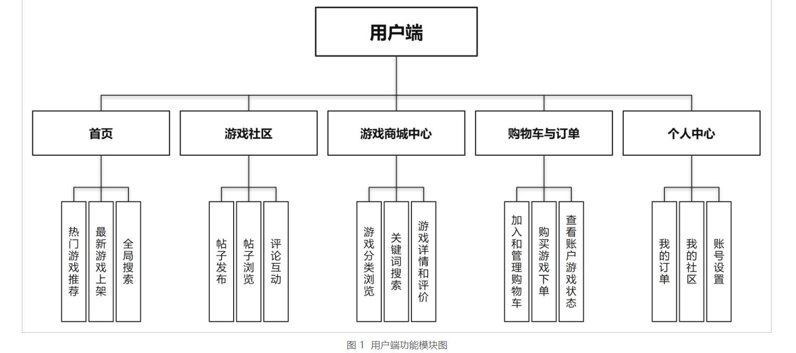
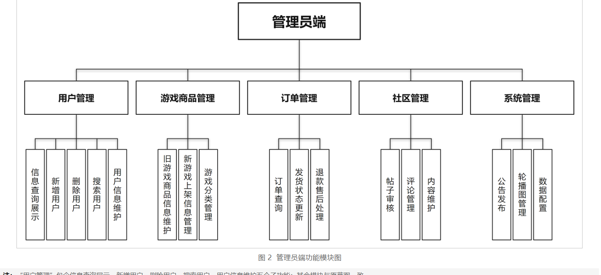

# 游戏商城系统

基于 **Spring Boot + Vue 3** 的前后端分离游戏商城，把"看游戏、买游戏、聊游戏、管账号"串成一条链路。

个人毕业设计项目，独立完成需求分析、数据库设计、后端接口、前端页面与测试。





## 功能模块（10 个）

**用户端**：首页（轮播/公告/推荐）、游戏社区（发帖/评论/审核）、游戏商场中心（分类/搜索/详情）、购物车与订单（下单/支付/取消/收货）、个人中心。

**管理端**：用户管理、商品管理（增删改/上下架）、订单管理（发货）、社区管理（帖子审核）、系统管理（公告/轮播/数据概览）。

## 技术栈

- 后端：Java 17、Spring Boot 3.2、MyBatis 3、JWT（HS256 手写实现）、BCrypt
- 数据库：MySQL 8 / H2 内存库（开箱即用）
- 前端：Vue 3、Vite 5、Element Plus、Vue Router、Axios

## 关键设计

1. **JWT 鉴权**：`JwtUtil` 自己实现 HS256 签名与验签，token 携带 `uid/role/exp`，拦截器统一校验并放行公开只读接口。
2. **防超卖**：`UPDATE product SET stock = stock - ? WHERE id = ? AND stock >= ?`，靠数据库条件更新保证并发安全。
3. **订单快照**：订单明细保存下单时的商品名与单价，商品改价或下架不影响历史订单。
4. **社区与商城联动**：帖子可关联商品，帖子默认待审核，管理端通过后才在前台可见。

## 目录结构

```
backend/     后端工程（Maven，src/main/java/com/wujuntao/mall）
frontend/    前端工程（Vite + Vue 3）
```

## 运行

**后端**（默认 H2，无需装数据库）：

```bash
cd backend
mvn spring-boot:run
# http://localhost:8080
# 管理员：admin / admin123
```

切换 MySQL：导入 `backend/sql/init.sql`，用 `-Dspring-boot.run.profiles=mysql` 启动。

**前端**：

```bash
cd frontend
npm install
npm run build
node serve.cjs     # http://127.0.0.1:5173
```

## 测试

- 后端主流程接口测试：32 项通过
- 社区与内容管理测试：21 项通过
- 前端服务与 API 代理测试：9 项通过

## 作者

湖南信息学院 软件工程 2023 级 · 吴俊涛
